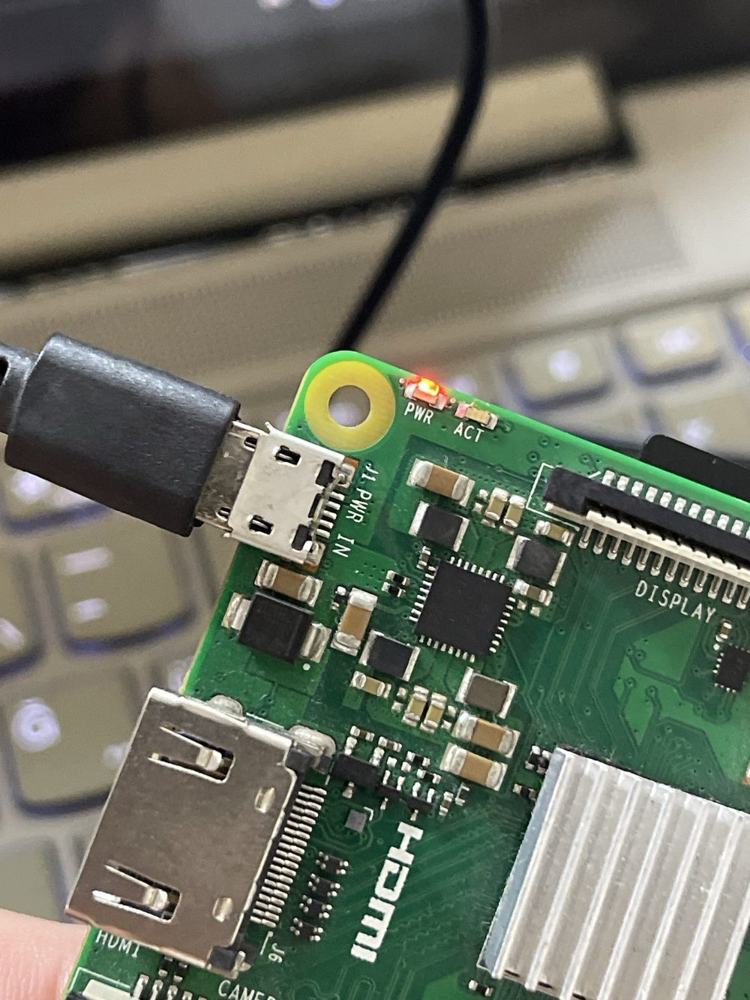
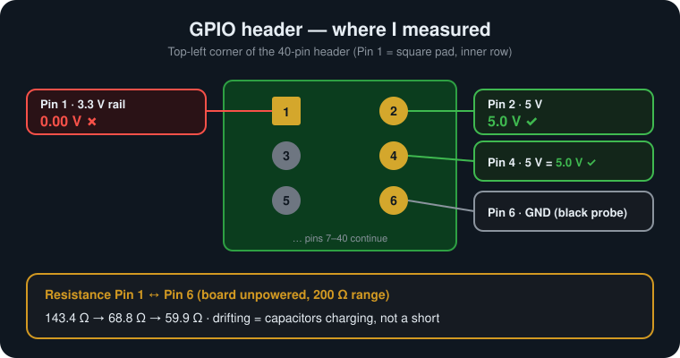
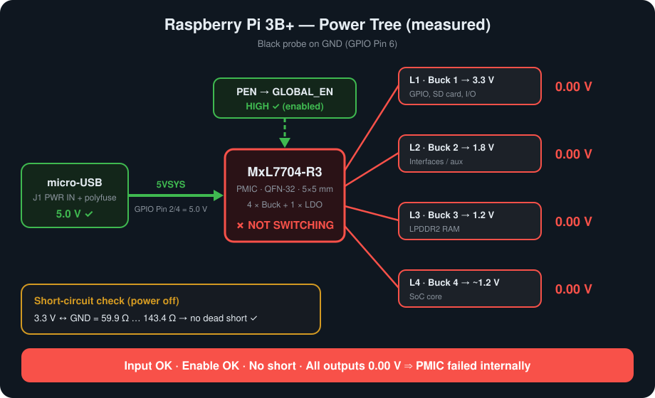
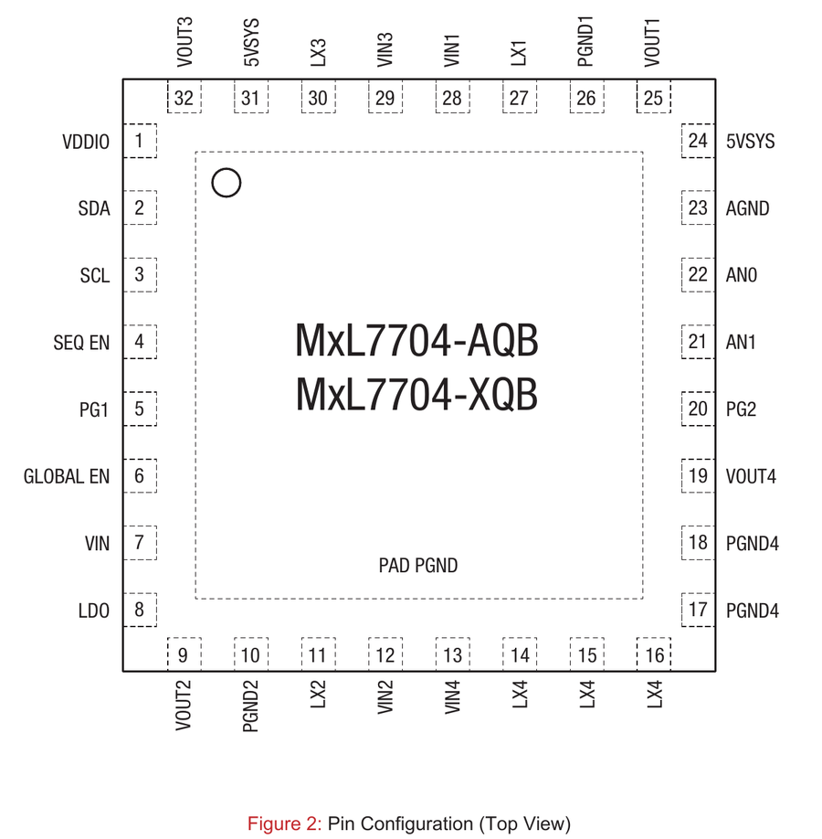
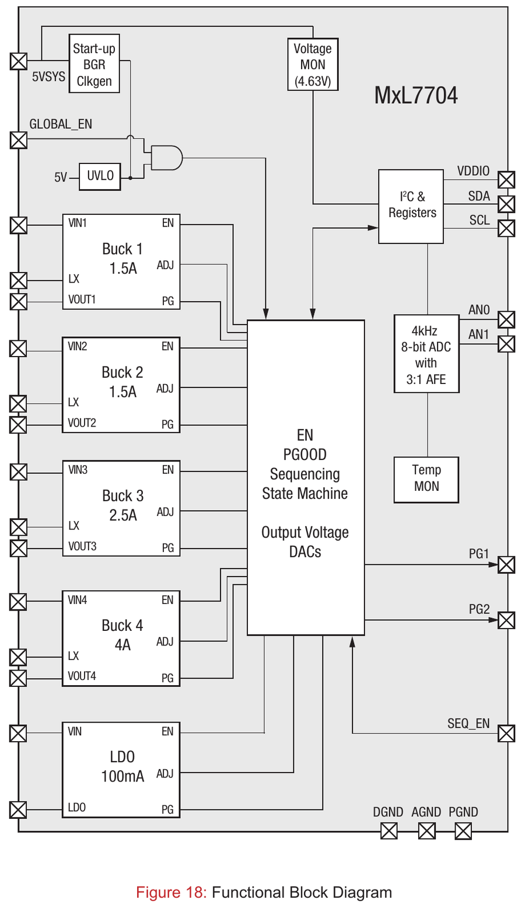
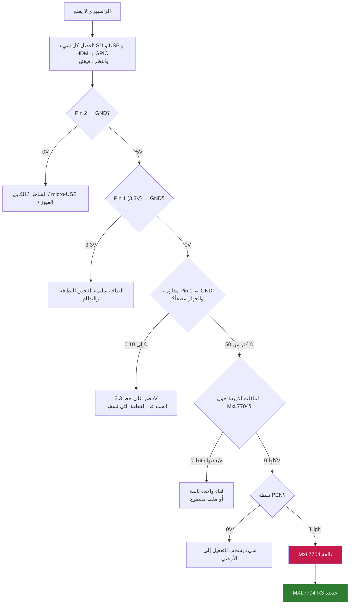

<a href="README.md">English</a> · <b>العربية</b>

# الجهاز الذي صمت فجأة

### كيف وصلتُ بملتيميتر واحد من "الشاحن خربان" إلى شريحة بحجم 5 مم داخل Raspberry Pi 3B+

  
   ضوء أحمر واحد… ولا شيء آخر.

---

الساعة الثانية فجرًا.

على المكتب راسبيري باي صغير. كان يشغّل الأفلام في بيتي سنة كاملة دون أن يشتكي مرة واحدة، ثم قرر في يوم عادي أن يصمت.

لا إقلاع. لا صورة. لا شيء.

هذه قصة الساعات التي تلت ذلك، بالترتيب، بما فيها الأخطاء التي كدت أرتكبها.

> **إن كنت مستعجلًا:** شريحة الطاقة على اللوحة ماتت. الكهرباء تدخل، وأمر التشغيل يصل، ولا يوجد قصر… لكن الشريحة لا تُخرج شيئًا.
> وإن كان جهازك صامتًا أيضًا، فانزل مباشرة إلى [خريطة التشخيص](#خريطة-التشخيص-لجهازك-أنت).

---

## الفصل الأول: كل المتهمين الخطأ

بدأت كما يبدأ الجميع: **الشاحن.**

غيّرته، فلا شيء. وعندما قلبت الشاحن البديل لأقرأ ما هو مكتوب عليه، وجدت **500mA**، والجهاز يحتاج خمسة أضعاف ذلك. ضحكت على نفسي قليلًا.

ثم جاءت الفكرة التي تبدو عبقرية في الثانية فجرًا: *"عندي علبة مليئة بالقطع، سأصنع شاحنًا بنفسي!"*
بعد دقيقتين من الحساب اكتشفت أنني أحاول أن أصنع **12 واط من 6**. والفيزياء لا تجامل أحدًا.

ثم أمسكت كابل USB لأوصل الراسبيري باللابتوب مباشرة، وقبل أن أدخله انتبهت إلى أن **طرفيه متشابهان**: مخرج 5 فولت في مواجهة مخرج 5 فولت.
أعدته إلى الدرج بهدوء، كأن شيئًا لم يكن

ثم **بطاقة الذاكرة**. فتحتها على اللابتوب ورأيت ملفات النظام كلها… ثم اختفت فجأة، ولم ألمسها. حاولت أن أكتب عليها نظامًا جديدًا، فرفضت: *write-protected*.

قلت لنفسي: **وجدتها!**

لم أكن قد وجدت شيئًا بعد.

---

## الفصل الثاني: عزل كل شيء

قررت أن أتوقف عن التخمين وأبدأ من الصفر:

- أخرجت بطاقة الذاكرة.
- فصلت كل شيء: USB، وHDMI، وأي سلك على أطراف GPIO.
- تركت اللوحة **دقيقتين** بلا كهرباء، حتى يعود الفيوز الحراري (Polyfuse) إلى وضعه إن كان قد فصل.
- ثم وصلت الكهرباء وحدها.

النتيجة: نفس الصمت.

الآن صار الأمر بيني وبين اللوحة فقط، ومعي ملتيميتر، أيقونة البطارية الضعيفة تومض في زاوية شاشته.

---

## الفصل الثالث: الملتيميتر يتكلم

السلك الأسود على الأرضي (**Pin 6**)، والأحمر يتنقل:

**Pin 2 و Pin 4:** خمسة فولت ثابتة.
يعني أن منفذ الشحن والفيوز ودائرة الحماية كلها بخير، والكهرباء تصل إلى اللوحة.

**Pin 1:** هنا يجب أن تكون **3.3 فولت**. هذه ليست كهرباء الشاحن، بل كهرباء **تصنعها اللوحة بنفسها** لتشغّل المعالج والذاكرة وبطاقة SD وكل شيء آخر…

**0.00**

يعني أنه حتى لو كانت البطاقة سليمة، ما كان الجهاز ليقلع أبدًا.

> فكرة خطرت لي وتراجعت عنها: "لماذا لا أحقن 3.3 فولت من الخارج في Pin 1؟"
> لأن المعالج يحتاج الجهود بترتيب زمني صارم (Power Sequencing). جهد واحد يصل وحده قد يقتله نهائيًا.

---

## الفصل الرابع: هل هناك من يسرق الكهرباء؟

قبل أن أتهم أي منظّم جهد، كان عليّ أن أتأكد من شيء: ربما هناك **مكثف محروق** أو قطعة تالفة تبتلع خط 3.3V كله، فلا يستطيع المنظّم أن يرفعه.

فصلت الكهرباء، وأدرت القرص إلى **200Ω**، وقست بين Pin 1 والأرضي:

**143.4Ω… 68.8Ω… 59.9Ω**

الرقم يتحرك، لكنه **بعيد عن الصفر**.
القصر الحقيقي يقرأ بين 0 و10 أوم تقريبًا. أما هذا الانجراف فهو المكثفات على الخط وهي تشحن من تيار الملتيميتر، وربما زادته بطارية الملتيميتر الضعيفة قليلًا.

إذن الكهرباء لا تُسرق في الطريق.

**إنها لا تُصنع أصلًا.**

---

## الفصل الخامس: أربعة ملفات بحجم حبة الأرز

بجانب منفذ الشحن (`J1 PWR IN`) وموصل الشاشة (`DISPLAY`) وجدت شريحة مربعة صغيرة، بلا أرجل ظاهرة، مكتوب عليها:

**MxL7704** هي مدير الطاقة (PMIC) في Raspberry Pi 3B+. تأخذ الخمسة فولت وتصنع منها كل ما يحتاجه الجهاز، وكل جهد يخرج عبر **ملف (Inductor)** صغير حولها.

لم أجرؤ على لمس أرجل الشريحة نفسها، فالمسافة بينها **0.4 مم**، وانزلاقة واحدة كفيلة بإحداث قصر جديد. لذلك قست على الأطراف المعدنية للملفات الأربعة:

| الملف | ماذا يغذّي | المتوقع | ما وجدته |
|:---:|---|:---:|:---:|
| L1 | النظام، GPIO، بطاقة SD | 3.3V | **0.00V** |
| L2 | الواجهات والدوائر المساعدة | 1.8V | **0.00V** |
| L3 | ذاكرة RAM | 1.2V | **0.00V** |
| L4 | نواة المعالج | ~1.2V | **0.00V** |

أربعة أصفار. الشريحة متوقفة تمامًا في قنواتها الأربع.

---

## الفصل السادس: السؤال الأخير

بقي احتمال واحد يجب أن أُسقطه: ربما الشريحة سليمة، لكن **أحدًا لم يطلب منها أن تعمل**؟

للشريحة طرف تشغيل اسمه `GLOBAL_EN`. ولمسه مباشرة على حافة الشريحة خطِر، لأنه ملاصق لطرف يحمل 5 فولت.
لكن الراسبيري يقدّم هدية صغيرة: ثقب اختبار مكشوف بجانب أطراف GPIO، أسفل الشعار، مكتوب بجانبه **`PEN`**، وهو متصل بنفس الإشارة.
(الثقب المجاور **`RUN`** خاص بإعادة تشغيل المعالج، ولا علاقة له بشريحة الطاقة.)

قست `PEN`: **جهد مرتفع (High).**

الشريحة تصلها الكهرباء، ويصلها أمر التشغيل…

**تسمع النداء، ولا تردّ.**

---

## داخل الشريحة: ماذا تقول ورقة البيانات

لأتأكد أن القياسات تشير فعلًا إلى الشريحة، عدت إلى ورقة بيانات MxL7704 وقارنت كل قراءة بالطريقة التي يفترض أن تعمل بها الشريحة.

توزيع الأطراف يطابق تمامًا ما قسته على اللوحة:

| الطرف | الاسم | وظيفته | ما وجدته |
|:---:|---|---|---|
| 7، 24، 31 | `VIN`، `5VSYS` | دخل 5 فولت | 5.0V تصل إلى اللوحة |
| 6 | `GLOBAL EN` | تفعيل الشريحة. إذا انخفض تتوقف الشريحة كلها | مرتفع، عبر نقطة `PEN` |
| 27 ← 25 | `LX1` ← `VOUT1` | Buck 1، من 3.0 إلى 3.6V، بتيار 1.5A | 0.00V على L1 |
| 11 ← 9 | `LX2` ← `VOUT2` | Buck 2، من 1.3 إلى 1.92V، بتيار 1.5A | 0.00V على L2 |
| 30 ← 32 | `LX3` ← `VOUT3` | Buck 3، من 0.8 إلى 1.6V، بتيار 2.5A | 0.00V على L3 |
| 14–16 ← 19 | `LX4` ← `VOUT4` | Buck 4، من 0.6 إلى 1.4V، بتيار 4A | 0.00V على L4 |
| PAD | `PGND` | وسادة الأرضي في منتصف أسفل الشريحة | يجب لحامها عند الاستبدال |

كل ملف يقع بين طرف `LX` (نقطة التبديل) وطرف `VOUT` الخاص به. لهذا كان القياس على طرفي الملف طريقة آمنة لقراءة كل قناة، من دون لمس أرجل المسافة بينها 0.4 مم.

المخطط الوظيفي يشرح لماذا ماتت المخارج الأربعة معًا، وليس واحدًا بعد الآخر:

- **الشريحة لا تبدأ إلا بشرطين:** أن يكون دخل 5V أعلى من حد الحماية من انخفاض الجهد (UVLO)، وهو حوالي **4.63V**، وأن تكون إشارة `GLOBAL_EN` مرتفعة. وقراءاتي تقول إن الشرطين متحققان: 5.0V في الدخل، والتفعيل مرتفع.
- **المخارج تبدأ على مجموعات، مجموعة بعد أخرى.** آلة التسلسل تنتظر أن تُبلغ كل قنوات المجموعة بأنها جاهزة (Power Good) قبل أن تبدأ المجموعة التالية. وإذا لم تنهض مجموعة، فلن تبدأ أي مجموعة بعدها.
- **إذن شريحة تصلها الكهرباء ومُفعّلة، لكن كل مخارجها على 0.00V،** هي شريحة توقفت عند أول خطوة في تشغيل نفسها.

> فحص إضافي قبل اللحام: منطق التسلسل يعني أن قصرًا تامًا على *أي* خط قد يوقف التشغيل كله أيضًا. أنا استبعدت القصر على خط 3.3V. وقياس المقاومة بين جهة الخرج في الملفات L2 وL3 وL4 والأرضي (والجهاز مطفأ) يستبعد الخطوط الثلاثة الباقية، ويؤكد أن الشريحة نفسها هي المشكلة.

المصدر: MaxLinear، <i>MxL7704 Data Sheet</i>، الإصدار 1B (2018).

---

## الحكم

| | |
|---|---|
| ✅ الدخل | 5.0V تصل إلى اللوحة |
| ✅ التفعيل | `PEN / GLOBAL_EN` مرتفعة |
| ✅ القصر | لا يوجد (59.9Ω إلى 143.4Ω) |
| ❌ المخارج | الأربعة على **0.00V** |
| **السبب** | **تلف داخلي في شريحة MxL7704-R3** |

> قلب الجهاز توقف، وأخذ معه بطاقة الذاكرة.
> وأظن أن شاحنًا غير مناسب استُخدم طويلًا كان يُرهق الاثنين ببطء.

---

## الفصل السابع: البحث عن التوأم

هنا اكتشفت أن هذه الشريحة **ليست قطعة عادية**.

MaxLinear تبرمج كل نسخة من MxL7704 في المصنع (**OTP**) بجهود وتسلسل تشغيل خاصين بالعميل. يعني أن نسخة الراسبيري تعرف بالضبط أي جهد يخرج أولًا، وبأي قيمة.
النسخ العامة (`MxL7704-AQB` و`MxL7704-XQB`) لا تعرف شيئًا عن الراسبيري، ولو لحمتها **لن تشغّل اللوحة**.

المطلوب حرفيًا: **`MXL7704-R3`**.
وهي متوفرة عند بائعين على eBay بحوالي **1.40$**. اشترِ قطعتين: واحدة للتركيب، وواحدة لليد التي قد ترتجف.

### قبل أن ألحمها، ثلاث نقاط فحص

1. **الكتابة على الشريحة:** امسحها بقطنة عليها كحول (IPA). إن زالت الكتابة فالشريحة **مُعاد طباعتها** (Remarked) ومزيفة.
2. **الوسادات السفلية:** الـ 32 والوسادة الوسطى (`PAD PGND`) يجب أن تكون نظيفة، بلا بقايا قصدير قديم.
3. **الصفارة:** لا يجب أن يكون هناك قصر بين أطراف الدخل والخرج والوسادة الوسطى.

---

## الفصل الثامن: نهاية البحث

انتهى البحث.

كل الاحتمالات سقطت، واحدًا بعد الآخر، بقياس بعد قياس. وما بقي يتسع في سطر واحد: **استبدال شريحة MXL7704-R3.**

ما تبقى لم يعد تشخيصًا، بل عملية لحام. واللوحة قالت كل ما تستطيع قوله.

بدأت الليلة بشاحن كنت متأكدًا أنه المذنب، وانتهت بشريحة أصغر من ظفر إصبعي. وبينهما أربعة أصفار، وثقب اختبار واحد، ولحظات كثيرة قلت فيها "وجدتها!" ولم أكن قد وجدت شيئًا.

<b>طريقة الفك والتركيب (اضغط للفتح)</b>

 

**١. التوثيق والحماية**
- صوّر الشريحة لتوثيق مكان علامة **Pin 1**.
- غطِّ موصل `DISPLAY` ومنفذي HDMI وmicro-USB بطبقتين من **Kapton** أو رقائق ألمنيوم سميكة.

**٢. الفك**
- فلَكس بكمية وافرة حول الشريحة.
- هواء ساخن **360 إلى 380°C**، بتدفق **30 إلى 40%**، وحركة دائرية على ارتفاع 1.5 إلى 2 سم.
- بعد **25 إلى 40 ثانية**، ارفع الشريحة **عموديًا** بالملقط، ولا تسحبها جانبيًا أبدًا.

**٣. تنظيف الوسادات**
- اسحب القصدير القديم بشريط النحاس (Solder Wick)، ثم نظّف بـ **IPA 99%**.
- ضع قصديرًا جديدًا رقيقًا ومستويًا على الوسادات الـ 32 والوسادة الوسطى.

**٤. التركيب**
- لمسة فلَكس خفيفة، ثم محاذاة دقيقة حسب **Pin 1**.
- هواء ساخن **350 إلى 365°C**، بتدفق **25 إلى 30%**، حتى تستقر الشريحة وحدها بفعل التوتر السطحي للقصدير.
- ضغطة عمودية خفيفة جدًا من الأعلى لضمان لحام الوسادة السفلية.

**٥. التحقق**
- بعد التبريد والتنظيف: قِس المقاومة بين 3.3V والأرضي، وبين 5V والأرضي، للتأكد من عدم وجود جسر قصدير.
- شغّل اللوحة **بدون بطاقة** وقِس الملفات الأربعة: **3.3V و1.8V و1.2V و~1.2V**.
- بعد ذلك فقط: بطاقة جديدة وشاحن مناسب 5V / 2.5A.

---

## خريطة التشخيص لجهازك أنت

إذا كان جهازك Pi 3B+ صامتًا، فاتبع الأسهم:

---

## ما بقي معي

**الأعطال لا تأتي دائمًا وحدها.** لو توقفت عند البطاقة التالفة لاشتريت بطاقة جديدة، ولبقي الجهاز صامتًا، ولما عرفت السبب أبدًا.

**ابدأ من الطاقة، وبالترتيب.** 5V، ثم 3.3V، ثم القصر، ثم المنظّم، ثم التفعيل. كل قياس يُسقط احتمالًا كاملًا.

**قِس حيث يكون القياس آمنًا.** أطراف الملفات وثقوب الاختبار بدل أرجل بعرض 0.4 مم.

**اقرأ ما هو مكتوب على القطع.** حرفان صغيران (`R3`) يفرقان بين قطعة تعيد الحياة للجهاز، وقطعة لن تفعل شيئًا.

**الشاحن ليس تفصيلًا.** هو ما يقرر كم سيعيش جهازك.

---

مراجع

- [Raspberry Pi: The custom power chip in the 3B+](https://www.raspberrypi.com/news/pi-power-supply-chip/)
- [Hackaday: Dead Raspberry Pi boards, PMICs, and new hope](https://hackaday.com/2023/03/24/dead-raspberry-pi-boards-pmics-and-new-hope)
- [Hackaday: PMIC failures on the Pi 3B+](https://hackaday.com/tag/mxl7704/)
- [MaxLinear: MxL7704 Universal PMIC](https://www.maxlinear.com/product/power-management/universal-pmics/universal-pmics/mxl7704-aqb-r)

 إذا أعادت هذه القصة جهازك إلى الحياة، أخبرني.

