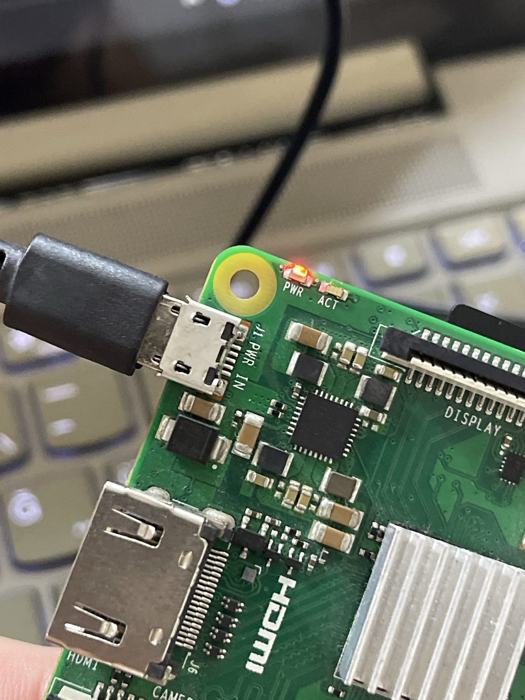
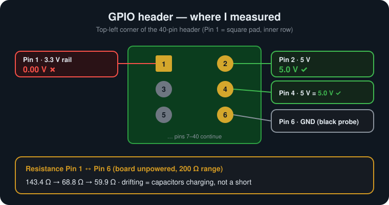
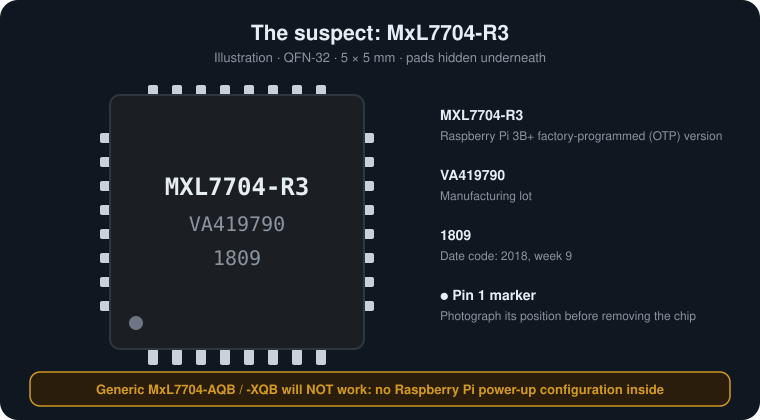
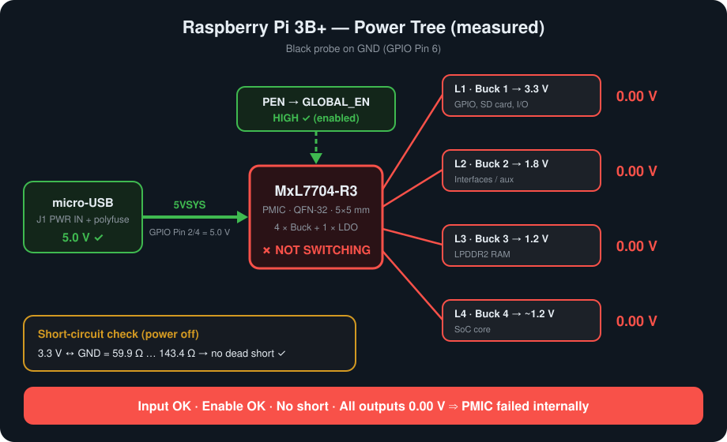
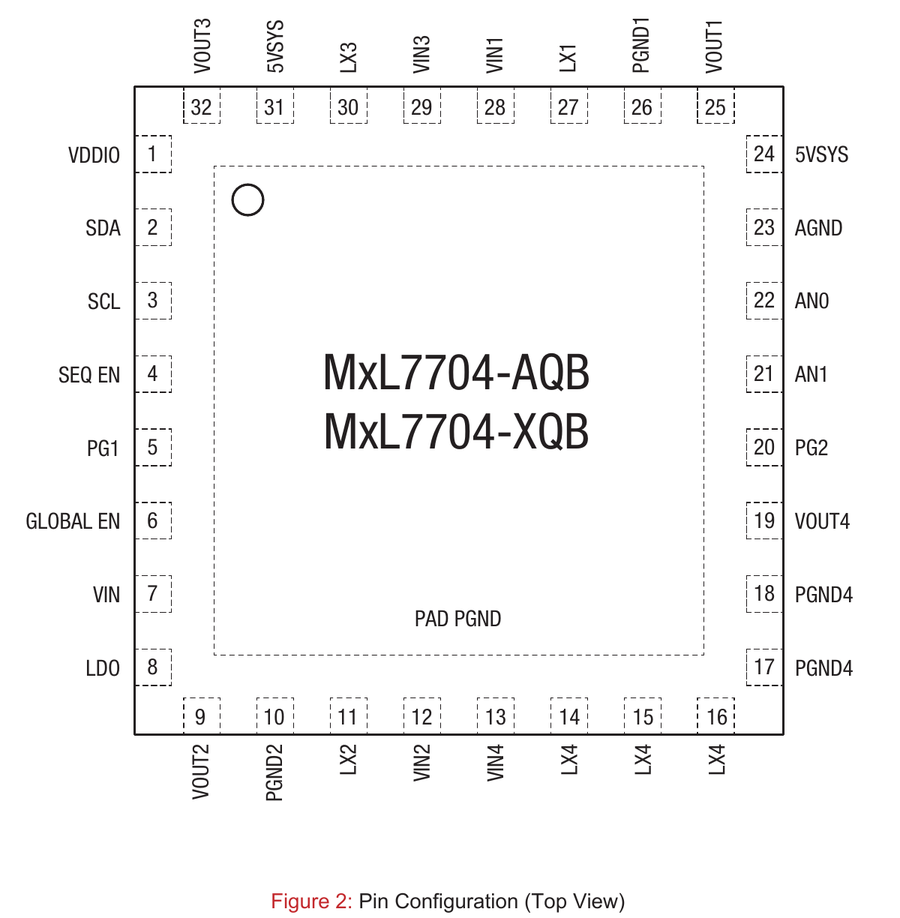
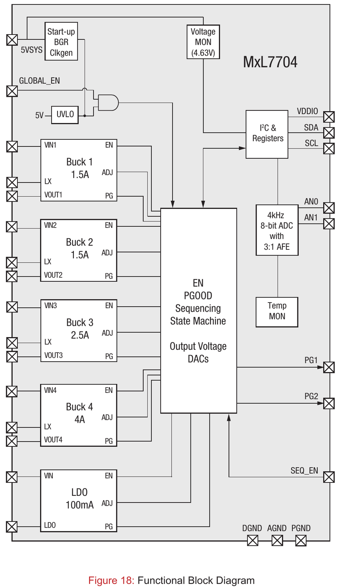
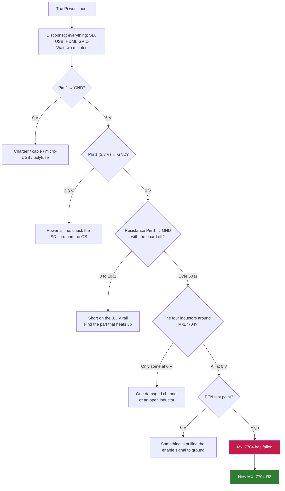

<b>English</b> · <a href="README.ar.md">العربية</a>

# The Pi That Went Silent

### How one multimeter took me from "the charger is broken" to a 5 mm chip inside a Raspberry Pi 3B+

  
   One red light… and nothing else.

---

2 a.m.

A small Raspberry Pi 3B+ on my desk: one of my oldest companions in my cybersecurity learning journey.

It was more than a tiny computer. It was my **Cybersecurity Home Lab**, running 24/7 for nearly a year, carrying my penetration testing experiments and network analysis practice without a single complaint. Then, on an ordinary day, it decided to go silent.

No boot. No picture. Nothing.

This is the story of the hours that followed, in order, including the mistakes I almost made.

> **In a hurry?** The board's power chip died. Power goes in, the enable signal is there, there's no short… and the chip outputs nothing.
> If your Pi has gone silent too, jump straight to the [diagnostic map](#a-diagnostic-map-for-your-pi).

---

## Chapter 1: All the wrong suspects

I started where everyone starts: **the charger.**

I swapped it. Nothing. When I flipped the replacement over to read the label, it said **500 mA**. The Pi needs five times that. I laughed at myself a little.

Then came the idea that only sounds brilliant at 2 a.m.: *"I have a box full of components. I'll build a power supply myself!"*
Two minutes of math later, I realized I was trying to get **12 watts out of 6**. Physics doesn't do favors.

Next, I grabbed a USB cable to power the Pi straight from my laptop, and just before plugging it in I noticed **both ends were the same**: a 5 V output facing another 5 V output.
I quietly put it back in the drawer, as if nothing had happened

Then **the SD card**. I opened it on the laptop and saw all the system files… then it vanished. I hadn't touched it. I tried to flash a fresh OS, and it refused: *write-protected*.

I told myself: **found it!**

I hadn't found anything yet.

---

## Chapter 2: Isolate everything

I decided to stop guessing and start from zero:

- Removed the SD card.
- Disconnected everything: USB, HDMI, and any wire on the GPIO header.
- Left the board unpowered for **two minutes**, so the polyfuse could reset if it had tripped.
- Then connected power, and power only.

Same silence.

Now it was just me and the board, and a multimeter with its low-battery icon blinking in the corner of the screen.

---

## Chapter 3: The multimeter speaks

Black probe on ground (**Pin 6**), red probe moving around:

**Pin 2 and Pin 4:** a steady five volts.
That means the input port, the polyfuse and the protection circuit are all fine. Power is reaching the board.

**Pin 1:** this should read **3.3 volts**. That isn't charger power; it's power **the board makes for itself** to run the processor, the RAM, the SD card and everything else…

**0.00**

So even with a perfect SD card, this Pi was never going to boot.

> An idea I had and dropped: "Why not inject 3.3 V into Pin 1 from outside?"
> Because the processor needs its voltages in a strict order (power sequencing). One rail arriving on its own can kill it for good.

---

## Chapter 4: Is something stealing the power?

Before blaming any regulator, I had to rule something out: maybe a **burnt capacitor** or a damaged part was swallowing the whole 3.3 V rail, so the regulator could never bring it up.

Power off. Dial to **200 Ω**. Measure Pin 1 to ground:

**143.4 Ω… 68.8 Ω… 59.9 Ω**

The number drifts, but it's **nowhere near zero**.
A real short reads somewhere around 0 to 10 Ω. This drift is the capacitors on the rail charging from the meter's test current, probably exaggerated a little by the meter's weak battery.

So the power isn't being stolen on the way.

**It's never being made in the first place.**

---

## Chapter 5: Four inductors the size of a grain of rice

Next to the power input (`J1 PWR IN`) and the display connector (`DISPLAY`) I found a small square chip with no visible legs. It said:

The **MxL7704** is the power management IC (PMIC) of the Raspberry Pi 3B+. It takes 5 volts and makes every other voltage the board needs, and each voltage leaves through a small **inductor** around it.

I didn't dare touch the chip's own pins: they're **0.4 mm** apart, and one slip of the probe could create a brand new short. So I measured on the metal ends of the four inductors instead:

| Inductor | Feeds | Expected | Measured |
|:---:|---|:---:|:---:|
| L1 | System, GPIO, SD card | 3.3 V | **0.00 V** |
| L2 | Interfaces, auxiliary circuits | 1.8 V | **0.00 V** |
| L3 | RAM | 1.2 V | **0.00 V** |
| L4 | CPU core | ~1.2 V | **0.00 V** |

Four zeros. The chip had stopped switching on all four channels.

---

## Chapter 6: The last question

One possibility was left to knock down: maybe the chip was fine, and **nobody had told it to turn on**?

The chip has an enable pin called `GLOBAL_EN`. Probing it directly at the chip's edge is risky, because it sits right next to a pin carrying 5 V.
But the Pi offers a small gift: an exposed test hole next to the GPIO header, below the logo, labelled **`PEN`**, wired to the same signal.
(The neighbouring **`RUN`** hole resets the processor and has nothing to do with the power chip.)

I measured `PEN`: **High.**

The chip has power, and it's being told to turn on…

**It hears the call, and doesn't answer.**

---

## Inside the chip: what the datasheet confirms

To be sure the measurements really pointed at the chip, I went back to the MxL7704 datasheet and checked each reading against how the chip is supposed to behave.

The pinout matches exactly what I probed on the board:

| Pin | Name | What it does | What I found |
|:---:|---|---|---|
| 7, 24, 31 | `VIN`, `5VSYS` | 5 V input | 5.0 V reaches the board |
| 6 | `GLOBAL EN` | Chip enable. Pulled low, the whole chip shuts down | High, via the `PEN` test point |
| 27 → 25 | `LX1` → `VOUT1` | Buck 1, 3.0 to 3.6 V, 1.5 A | 0.00 V on L1 |
| 11 → 9 | `LX2` → `VOUT2` | Buck 2, 1.3 to 1.92 V, 1.5 A | 0.00 V on L2 |
| 30 → 32 | `LX3` → `VOUT3` | Buck 3, 0.8 to 1.6 V, 2.5 A | 0.00 V on L3 |
| 14–16 → 19 | `LX4` → `VOUT4` | Buck 4, 0.6 to 1.4 V, 4 A | 0.00 V on L4 |
| PAD | `PGND` | Centre ground pad under the chip | Must be soldered on replacement |

Each inductor sits between an `LX` pin (the switching node) and its `VOUT` pin, which is why measuring both ends of the inductor is a safe way to read each channel without touching the 0.4 mm pins.

The block diagram explains why all four outputs died together instead of one by one:

- **The chip only starts when two conditions are met:** the 5 V input is above the undervoltage lockout (UVLO) threshold of about **4.63 V**, and `GLOBAL_EN` is high. My readings say both were true: 5.0 V in, enable high.
- **The outputs start in groups, one group after another.** The sequencing state machine waits for every channel in a group to report "power good" before it starts the next group. If one group never comes up, none of the following groups are started.
- **So a chip that is powered and enabled, but shows 0.00 V on every output,** has stalled at the very first step of its own startup.

> One more check before soldering: the sequencing logic means a dead short on *any* rail could also stop the whole startup. I ruled out a short on the 3.3 V rail; measuring the resistance from the output side of L2, L3 and L4 to ground (board unpowered) rules out the other three and confirms the chip itself is the problem.

Figures: MaxLinear, <i>MxL7704 Data Sheet</i>, Rev 1B (2018).

---

## The verdict

| | |
|---|---|
| ✅ Input | 5.0 V reaches the board |
| ✅ Enable | `PEN / GLOBAL_EN` is high |
| ✅ Short | None (59.9 Ω to 143.4 Ω) |
| ❌ Outputs | All four at **0.00 V** |
| **Root cause** | **Internal failure of the MxL7704-R3 PMIC** |

> The heart of the board stopped, and took the SD card with it.
> My guess is that an unsuitable charger, used for a long time, was slowly wearing them both down.

---

## Chapter 7: Looking for a twin

This is where I learned that this chip is **not an ordinary part**.

MaxLinear programs every MxL7704 at the factory (**OTP**) with voltages and a power-up sequence specific to the customer. So the Raspberry Pi version knows exactly which voltage comes up first, and at what level.
The generic versions (`MxL7704-AQB`, `MxL7704-XQB`) know nothing about the Pi. Solder one on, and **the board won't start**.

The exact part needed: **`MXL7704-R3`**.
It's available from sellers on eBay for about **$1.40**. Buy two: one to fit, and one for the hand that might shake.

### Three checks before soldering it

1. **The marking:** rub it with a cotton swab and isopropyl alcohol (IPA). If the text wipes off, the chip has been **remarked**, and it's fake.
2. **The bottom pads:** all 32 pads and the centre pad (`PAD PGND`) should be clean, with no leftover solder.
3. **The beep test:** there must be no short between the input/output pins and the centre pad.

---

## Chapter 8: The end of the search

The search is over.

Every branch has been ruled out, one measurement at a time, and what's left fits in a single line: **replace the MXL7704-R3.**

What remains is no longer a diagnosis. It's a soldering job, and the board has already told me everything it can.

The night started with a charger I was sure was guilty, and ended with a chip smaller than my fingernail. In between were four zeros, one test hole, and a lot of "found it!" moments that turned out to be wrong.

<b>Removal and replacement procedure (click to open)</b>

 

**1. Document and protect**
- Photograph the chip to record where the **Pin 1** marker is.
- Cover the `DISPLAY` connector and the HDMI and micro-USB ports with two layers of **Kapton** tape or thick aluminium foil.

**2. Remove**
- Plenty of flux around the chip.
- Hot air at **360–380 °C**, airflow **30–40 %**, moving in circles 1.5–2 cm above the board.
- After **25–40 seconds**, lift the chip **straight up** with tweezers. Never slide it sideways.

**3. Clean the pads**
- Remove the old solder with solder wick, then clean with **99 % IPA**.
- Apply a new, thin, flat layer of solder to the 32 pads and the centre pad.

**4. Fit the new chip**
- A light touch of flux, then precise alignment using **Pin 1**.
- Hot air at **350–365 °C**, airflow **25–30 %**, until the chip settles into place on its own through the solder's surface tension.
- A very gentle vertical press from above to make sure the centre pad is soldered.

**5. Verify**
- Once it has cooled and been cleaned: measure resistance from 3.3 V to ground and from 5 V to ground, to make sure there are no solder bridges.
- Power the board **without an SD card** and measure the four inductors: **3.3 V, 1.8 V, 1.2 V, ~1.2 V**.
- Only then: a new SD card and a proper 5 V / 2.5 A power supply.

---

## A diagnostic map for your Pi

If your Pi 3B+ has gone silent, follow the arrows:

---

## What stayed with me

**Faults don't always come alone.** If I had stopped at the dead SD card, I would have bought a new one, the Pi would have stayed silent, and I would never have known why.

**Start with power, and in order.** 5 V, then 3.3 V, then shorts, then the regulator, then the enable signal. Each measurement rules out a whole branch.

**Measure where it's safe to measure.** Inductor ends and test holes, not pins 0.4 mm apart.

**Read what's printed on the parts.** Two tiny characters (`R3`) are the difference between a part that brings the board back to life and one that does nothing.

**The power supply is not a detail.** It decides how long your board lives.

---

References

- [Raspberry Pi: The custom power chip in the 3B+](https://www.raspberrypi.com/news/pi-power-supply-chip/)
- [Hackaday: Dead Raspberry Pi boards, PMICs, and new hope](https://hackaday.com/2023/03/24/dead-raspberry-pi-boards-pmics-and-new-hope)
- [Hackaday: PMIC failures on the Pi 3B+](https://hackaday.com/tag/mxl7704/)
- [MaxLinear: MxL7704 Universal PMIC](https://www.maxlinear.com/product/power-management/universal-pmics/universal-pmics/mxl7704-aqb-r)

 If this story brings your Pi back to life, let me know.

